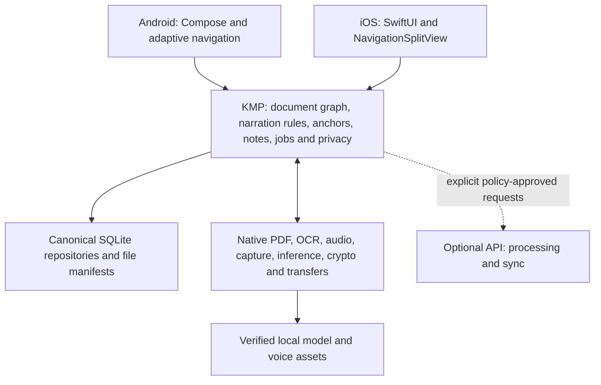
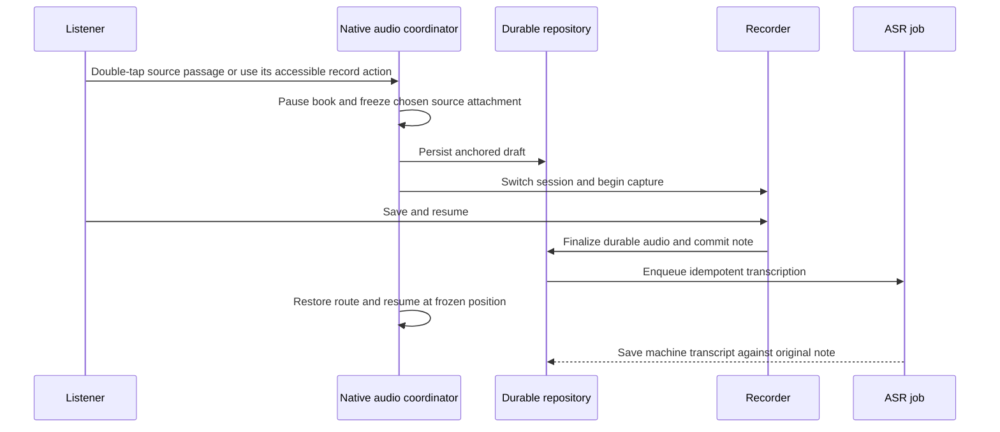

# Architecture

Status: **native listening, notes, preparation and downloadable speech are implemented; release qualification remains**. Research baseline: 4 October 2026. This document specifies architectural responsibilities. See [docs/development.md](docs/development.md) for actual execution evidence and physical-device limits.

## 1. Product contract

The product is a listening-first PDF app. A useful first release turns ordinary PDFs into reliable narration, follows the active passage visually, and lets a listener record a thought at that passage without disrupting the session. English and accessibility receive launch-level attention. Multilingual text, speech and note metadata exist from the beginning.

The central guarantees are:

1. Narration, highlighting, seeking and notes refer to the same underlying source.
2. A voice note attaches to the chosen source passage, frozen before recording starts; narration keeps its own confirmed pause position. Its original audio survives ASR failure.
3. Save and resume do not wait for transcription. Restart and interruption recovery preserve committed notes and listening progress.
4. Core use works locally. A strict local-only policy has no hidden cloud fallback.
5. Optional enhanced voices can be downloaded and selected. Larger models are qualified capabilities, not requirements for every supported device.
6. Native audio survives navigation and window changes. Wide layouts add context without changing the session's ownership.

Product scope and journeys are in [docs/product.md](docs/product.md); appearance and adaptive behavior are in [docs/design.md](docs/design.md).

Both apps use `com.osuji.ereaderapp`, version `0.01` and initial build/version code `1`. The UI quality requirement includes rich intentional haptics, Metal-backed effects on iOS, AGSL/native effects on Android, responsive input and measured frame/memory/energy budgets. Native feedback/effect ownership stays outside KMP; shared semantic intents can drive it. Feedback and decorative motion are enabled app behavior rather than app preferences; native owners still honor OS accessibility settings, hardware capability and resource pressure. Library actions and sheet content follow the shared arrangement in [docs/design.md](docs/design.md). See [docs/ui-quality.md](docs/ui-quality.md).

## 2. KMP backbone with native interfaces

Use Kotlin Multiplatform from the beginning for the domain, canonical data contracts, transformations, repositories and orchestration policy. Use Compose for Android and SwiftUI for iOS. Share behavior where it should be identical; keep hardware and OS lifecycle under native ownership. This is a KMP core with two native apps, rather than a shared UI application. [KMP sharing guidance](https://kotlinlang.org/docs/multiplatform/multiplatform-share-on-platforms.html)

These are responsibility boundaries. Start with a small number of modules and add boundaries when they reduce coupling; do not create a package for every diagram box.

| Area | Shared KMP responsibility | Native responsibility |
| --- | --- | --- |
| Documents | Identity, graph, reading order contracts, normalization, source mappings and search rules | Import access, PDF rendering/extraction, OCR and coordinate conversion |
| Narration | Segments, editions, queue plans, cache identity and source alignment contracts | Downloaded model execution, audio output and validated timing |
| Playback | User commands, durable progress, preparation policy and presentation snapshots | Transport clock, media session, audio focus/routes, interruptions and background lifetime |
| Notes | Frozen anchors, records, transcript revisions, job state and conflict rules | Microphone permission, capture, recoverable files and audio-session transitions |
| Persistence | One schema, repositories, transactions, outbox and recovery rules | Database driver, protected files, keys and backup exclusions |
| Networking | Ktor API contracts, request policy, authentication state and retries | Engine configuration and OS-managed durable background transfers |
| Models | Catalog contracts, eligibility policy, manifests and installation state | Runtime compatibility, loading, compilation, resource measurement and inference |
| UI | Immutable domain snapshots and intent contracts | Native navigation, accessibility, focus, gestures and adaptive layout |

Ktor uses platform engines; its Darwin engine uses `NSURLSession`. Large durable downloads need native background-transfer adapters rather than an assumption that an ordinary shared request survives suspension. Koin wires shared services and Android dependencies; iOS receives explicit factories through a small Swift facade. [Ktor engines](https://ktor.io/docs/client-engines.html), [Koin KMP](https://insert-koin.io/docs/reference/koin-mp/kmp/)

Expose commands, stable IDs, immutable values and lifecycle-controlled subscriptions across the Swift boundary. Keep PCM, tensors, PDF objects and render buffers native. The established Kotlin/Native framework route is the initial conservative option; current Swift export remains Alpha and requires qualification behind the same facade. [Swift export](https://kotlinlang.org/docs/native-swift-export.html)

## 3. Canonical document graph

A PDF's drawing order is not necessarily its reading order. Extraction quality is a first-class part of the listening experience, not an import utility to bolt on after TTS.

### Representations

Maintain three explicit, versioned representations:

- **Source:** faithful extracted text, page geometry and provenance. It is the reference for notes and source highlights.
- **Reading:** accessible display text and semantic source context, with layout artifacts removed under defined policy. The visible reader remains the original PDF rather than a separate reflow pane.
- **Spoken:** text prepared for pronunciation and narration, with an explicit mapping to source and reading ranges.

Mappings are many-to-many. A single source token such as `$45` may produce several spoken words; a removed running header has no spoken range. Never recover source positions by counting characters in generated audio text alone.

The graph contains logical document identity, content revision, extraction version, pages, blocks, headings, reading-order edges, source ranges, quadrilaterals, language and confidence/provenance. A logical document ID is separate from a file checksum: adding an exported annotation may change bytes without changing the referenced passage.

Use **UTF-16 code-unit offsets into an immutable, versioned canonical source string** for persisted text ranges. Endpoints cannot split surrogate pairs. Swift must convert explicitly to `String.Index`; Kotlin and Swift grapheme counts are not interchangeable. Qualification includes emoji, combining marks, non-Latin scripts and right-to-left text. `SourcePage.geometrySpace = cropTopLeftV1` identifies normalized top-left coordinates in the unrotated PDF crop box. Native adapters apply page rotation, crop placement, zoom and pan when painting and hit testing.

Never guess the coordinate convention of untagged geometry. Preserve the source and user data, then freshly prepare that original page and prove the canonical text before replacing only its geometry. Embedded text must equal the complete fresh page text, or that complete text trimmed only at its outer whitespace; the latter requires a literal UTF-16 prefix offset for every mapped range. OCR requires exact whole-page equality. Substring, fuzzy and internal-whitespace matching are excluded. Geometry repair cannot rewrite a source revision, passage, note attachment or reading position. Unverified geometry has no interactive highlight; listening, accessible source context and the playback-dock note action remain available.

### Incremental preparation

1. Import a seekable PDF and retain dependable local access. An app-owned copy is the simplest initial approach; record its relationship to the original.
2. Render the first useful page immediately. Extract nearby embedded text and geometry before scanning the whole document.
3. Detect unusable text, missing text, duplicates and uncertain order. OCR pages that need it using Apple Vision and bundled Tesseract English. Android parses and renders PDFs in an isolated process; the app receives bounded text/geometry or a bounded raster for local OCR.
4. Build reading order and deterministic normalization. Preserve confidence, source provenance and explicit user corrections.
5. Segment by sentences and paragraphs, independent of page boundaries. Schedule near-term narration first; index and prepare the remainder within resource limits.

Normalization covers hyphenation, whitespace, repeated headers/footers, abbreviations and pronunciation. Footnotes, captions and tables have visible policies; uncertain content is not silently invented or discarded. Complex equations and tables may require a source-aware alternate presentation or a deliberate skip choice. A general LLM is not necessary for this baseline.

The source graph drives narration, search and accessible source context. Native PDF surfaces display the faithful page and highlight mapped geometry. Double-tapping prepared text dispatches pause-and-record against its expected document, revision and passage identity; stale geometry must never attach to another passage. The frozen note source and paused book cursor are separate. Native hit testing accounts for the rendered page, crop, rotation, zoom and pan. Blank-space taps and browsing gestures do not record or seek. An uncertain extraction retains the original page and an explicit repair/preparation state.

Native PDF surfaces preserve the source page's colours, typography, text and artwork in light and dark app appearance. Android displays its bounded original raster; iOS uses PDFKit's original page drawing. Narration overlays remain separate from page content and use the same canonical geometry as capture hit testing. The surrounding canvas and controls follow the app theme. Theme changes do not transform page pixels, rewrite source PDFs or change OCR inputs, canonical text, geometry or anchors.

## 4. Durable data contracts

| Record | Essential information |
| --- | --- |
| Document | Logical ID, source revision, file fingerprint/access manifest, title/language, graph version and preparation state |
| SourceAnchor | Document/revision/graph IDs, block ID, source range, page geometry, quote and context fallback |
| NarrationEdition | Document revision, normalization versions, provider/model/voice snapshot and synthesis settings |
| NarrationSegment | Spoken text/range, source mappings, audio manifest, duration and alignment precision/version |
| PlaybackCursor | Source anchor plus narration edition, segment, native audio offset and measured passage fraction; save time and local session identity |
| Note | Stable ID, chosen frozen source attachment and supplemental passage audio offset, capture status, recording manifest, timestamps and optional user text |
| TranscriptRevision | Machine output, language/provider provenance, user-edited text and edit revision; original recording retained |
| Job | Stable ID, task, input revision/hash, selected model, checkpoints, attempts, output manifest and cancel/generation state |
| ModelInstall | Catalog/version/platform/runtime identity, verified asset hashes, eligibility result and active installation state |
| SyncOutbox | Stable operation ID, record revision, retry state and deletion/conflict metadata |

A note's source attachment survives changes to voice or synthesis. Its audio offset supplements that passage when it is the current narration; an off-current note uses offset zero. The book's paused playback cursor remains separate and determines save/resume.

Re-extraction builds a new graph; reconcile anchors using retained mappings and source context. Ambiguous matches require review and preserve the original attachment. This is an integrity requirement, not a promise to keep obsolete internal APIs during development.

## 5. Playback and synchronization

One native transport is the authoritative clock. Shared orchestration plans segments and preparation; it does not run a second timer that competes with the actual player. Playback ownership exists above individual screens.

Native player presentations share the arrangement in [docs/design.md](docs/design.md): document identity, visible speed, output volume and transport above a whole-file source-progress slider, with a percentage immediately to its right. UI speed commands use the existing native audio owner; the control does not create another playback clock or seek the document. Width changes can move transport to a centered second row without reconstructing playback.

- Android: Media3 player and media session, with background ownership in a suitable session service.
- iOS: native audio transport and serialized audio interaction coordinator, integrated with system media controls.

Maintain segment audio together with source-to-spoken mappings and alignment metadata. An alignment track declares **word, sentence or passage precision**. If a voice only supports sentence alignment, use that honest precision. Do not spread word timings uniformly over a segment and claim accuracy.

Generated narration uses native media time as its clock. Qualify any model alignment track before presenting word timing; the current Phonon adapter provides passage-level highlighting. Only one native transport is active at a time. It maps measured media position through the narration edition to source progress. Playback speed must not rely on a separate wall-clock estimate. System speech execution and speech-range clocks are removed.

Cache keys include document/graph and normalization revisions, model/voice version, language and audio-affecting synthesis settings. Changing playback speed at transport level normally does not require regeneration. A voice change creates a new edition and maps the current source point into it; do not mix incompatible segment/alignment files.

Phonon's English speaker profiles share the same installed engine and model weights. Shared catalogue metadata supplies the stable speaker ID, display name, language tag and narrator/character category. Native code checks profile availability and serializes speaker selection with synthesis. Selecting another speaker cancels and joins affected generation, preserves source progress, and cannot silently fall back to the default speaker. Cache identity includes the speaker ID; downloaded models and user recordings are unaffected by a speaker selection.

Bound near-term prefetch by readiness, battery, memory and thermal state. Arbitrary source seeking may require generation; show that preparation truthfully. Keep the selected voice stable, and ask through an explicit product choice before changing providers or voice quality. Prepare selected chapters in advance when generation is slower than consumption.

## 6. Pause, capture, save and resume

Serialize playback/capture transitions so narration cannot continue into the recording and the attachment cannot drift. Use a journal and a qualified recoverable recording format or short chunks. A process killed during an unfinalized container may leave unusable audio; recovery needs design and device testing rather than a promise that every partial file is playable.

Only show “Saved — transcribing” after the audio manifest and note are durably committed. Capture permission failure offers typed input at the same frozen point. Low storage, interruptions and unexpected termination preserve any recoverable draft and make its status explicit. Do not automatically resume narration after an unexpected capture interruption.

ASR uses a saved immutable recording revision. Late/retried results cannot move the anchor, attach to another note or overwrite a user's edited transcript. Store machine output separately and apply updates only against a matching job/input generation. Saving another note while earlier notes are transcribing is supported.

Translation is a separate later operation on the transcript; it retains original audio and text. Voice commands, live conversational assistance and recording the narration itself are outside the initial note journey.

## 7. Local model and resource strategy

Narration requires an explicitly downloaded, verified and selected Phonon pack. System TTS and system ASR are excluded. Kitten and Kokoro narration are retired; a future pack must demonstrate a useful quality, language, accessibility or resource advantage over Phonon before adding another adapter. Settings owns voice selection and access to curated **Offline voices** and **Voice-note transcription** packs, with language, storage, suitability and readiness. Voices are used for document narration; there is no separate sample-playback feature. Model execution is task-specific; do not force TTS and ASR into a large general model.

The gallery borrows the discover/download/run pattern from [Google AI Edge Gallery](https://github.com/google-ai-edge/gallery). Its implementation and benchmarks are references, not our production architecture or a guarantee that arbitrary imported models run on both platforms.

### Pack manifest and installation

A signed catalog identifies the task, exact artifact version, platform, minimum OS, runtime/ABI, tokenizer/frontend, language, license/provenance, sample rate, quantization, asset dependencies, checksums, download URL, storage estimates and tested device profiles. Voice assets can depend on a shared engine; installing several voices should not duplicate it. The shared store accepts bounded, monotonic catalogue updates only after native P-256 signature verification and publication-date checks. New catalogues have no expiry or renewal requirement. Supported adapter profiles and immutable model editions protect installed and unfinished packs. [Model manager](docs/model-manager.md) defines the actual update and release setup contract.

Installation progresses through availability, download, verification, optional compilation, compatibility check and atomic activation. Resume partial downloads only after validating remote version/length. Validate hashes, archive paths and disk headroom. Keep a previously working artifact until its replacement is ready, and recover interrupted installs. Deleting a pack removes its regenerable resources; it never deletes voice notes.

Curate artifacts first. Arbitrary model import is a later advanced capability with explicit supported formats and validation. An upstream ONNX model is not automatically a LiteRT or CoreML artifact.

### Capability tiers

| Tier | Intended experience |
| --- | --- |
| Baseline | Local document display and durable note capture without speech packs; listening begins after a verified voice download |
| Compact local | Downloaded Phonon narration and Whisper note ASR, bounded prefetch and one heavy inference task at a time |
| Enhanced local | Larger optional voices/ASR on measured compatible devices, with explicit storage and preparation behavior |
| Optional cloud | Explicit remote voice, note ASR or document processing, governed separately by privacy policy and budget |

Capability depends on measured working memory and sustained workload, not a “flagship” label or advertised RAM alone. A short post-download check detects basic incompatibility; lab qualification and runtime monitoring establish longer-session behavior.

Real-time factor is synthesis time divided by produced audio duration. At 2× playback, generation must remain below 0.5 with headroom; a proposed engineering target is about 0.3–0.35 under the defined sustained workload. This is a target, not a measured fleet result. Pregeneration helps a slow model that fits memory; it cannot rescue an out-of-memory model.

Priority is capture and audible playback, then immediate prefetch, saved-note ASR, and bulk preparation/indexing. Defer optional work under pressure. Native adapters expose cancellation/checkpoints and resource measurements; limit joint PDF bitmap and inference memory, not just each cache independently.

“Pack installed” and “chapter ready offline” are different states. Readiness includes the actual voice, prepared audio, source graph and chosen transcription capability. Show exactly what remains available without the network.

## 8. Persistence and recovery

Use one canonical SQLite schema and repository layer through KMP, with native drivers and file/crypto adapters. **SQLDelight is the initial implementation choice**, with a thin JSON facade across the Kotlin/Native framework for Swift. Qualify its concurrency, file protection and performance on actual devices. Do not create independent Android/iOS schemas or a second SwiftData truth. Start with lexical search; vector search must justify its complexity through a defined task.

Database transactions own domain state; file manifests/journals bridge transactions to audio and model files. Reconcile missing, incomplete and orphaned files on launch. Jobs use stable IDs, input revisions, bounded checkpoints and idempotent completion. In-flight jobs recover into a safe resumable or failed state after process termination.

Use an LRU or quota policy for regenerable narration and rendered pages. Original PDFs, raw recordings and user edits have explicit retention/export rules and must not disappear as collateral cache eviction. Model deletion and changing voices do not affect notes.

Document export takes a read-only canonical snapshot after native progress is flushed, validates finalized source and saved-note anchors, and stages immutable asset copies before building a bounded manifest-first ZIP. Exported WAVs are portable; iOS decrypts only into protected transient staging. Native file pickers own the chosen destination. Both platforms restore the same format, retain source-based progress and discard the exporting device’s native audio-clock offset. Cancellation and failure clean temporary export assets without deleting source documents or recordings.

Native background execution is constrained. Active background audio does not grant unlimited OCR/ASR/model generation time. Persist work and resume when the OS allows it; do not promise transcription always finishes while the app is closed.

## 9. Privacy, networking and optional services

Local-first is the default architecture. **Local-only** is an enforceable content-egress policy, distinct from the physical device being offline. Public model downloads can be separately allowed, without uploading document data. Explain that downloads still expose ordinary CDN/network metadata.

Use independent choices for:

| Choice | Data that may leave the device |
| --- | --- |
| Cloud narration | Selected document text and voice settings |
| Cloud note transcription | Selected saved recording and related language hints |
| Cloud document preparation | Selected PDF/page images and extraction settings |
| Account sync | Selected documents, progress and notes under the stated encryption design |
| Diagnostics | Minimal operational metrics; no document text, filenames, quotes, audio or transcripts in ordinary logs |

Enforce the policy at provider dispatch and transfer boundaries, including retries. Never route a failing local task to cloud silently. Local use does not require an account.

Use platform key storage and protected/encrypted durable files. Include draft audio, database journals, transcript indexes and temporary material in the threat model. Lock-screen playback and capture recovery require compatible key/file availability. Device-only keys, backup recovery and cross-device keys have different properties; decide and test before promising restoration.

Provider “no training” does not mean zero retention. Verify the selected endpoint, account tier, logging and retention configuration. Do not claim end-to-end encryption unless the complete key, recovery and sync design provides it. Optional cloud inference necessarily receives the selected plaintext input unless a specific alternative processing design is proven.

### Optional backend

Start with a modular API service, workers, PostgreSQL, object storage and a durable queue if remote processing or sync is needed. Add provider adapters, authentication, idempotency, quotas, cancellation and cost accounting. A microservice fleet is unnecessary for the first release.

Keep paid provider keys off the client. Stream/cache reusable narration with bounded retention and signed access. Record actual billable generation, including discarded prefetch and regeneration. Model download hosting and cloud inference are separate cost centers.

Sync uses stable IDs, an outbox, conflict policy and deletion tombstones. Machine transcripts cannot overwrite user edits. Incoming playback progress must not jump a currently active local player; offer reconciliation at a natural session boundary. End-to-end encrypted sync is a separate design decision, not a property supplied automatically by object storage or iCloud.

## 10. Platform and delivery decisions

| Decision | Status |
| --- | --- |
| Listening-first, anchored voice notes, English first | Agreed |
| KMP shared core; native Compose and SwiftUI | Agreed |
| Android requested stack; iOS 18+, Swift/CoreML | Agreed |
| Local-first, strict local-only, curated packs, optional cloud | Agreed |
| Wide-window layouts and accessible controls | Agreed |
| One shared SQLite schema | Implemented with SQLDelight; native adapters use the same canonical store |
| SQLite library and Swift bridge | Initial implementation: SQLDelight and a Kotlin/Native framework with a thin JSON facade; device/performance qualification remains |
| Android minimum API and exact SDK versions | API 28 floor; pinned current build stack compiles, with API 37 emulator evidence and older physical-device qualification pending |
| Custom local TTS/ASR artifacts | Bake off on physical supported devices |
| Recoverable recording format and encryption/recovery | Implemented bounded PCM recovery on Android and authenticated chunk vault on iOS; synthetic interruption checks passed, physical capture/route gates remain |
| Cloud provider, paid tier and sync | Optional; choose from evaluated quality, retention and cost |

See [Android](docs/android.md), [iOS](docs/ios.md), [model evaluation](docs/models-and-evaluation.md) and [roadmap](docs/roadmap.md) for platform details and acceptance gates. The core sequence is source integrity, reliable listening, durable capture, qualified packs, then wider language and optional intelligence features.
