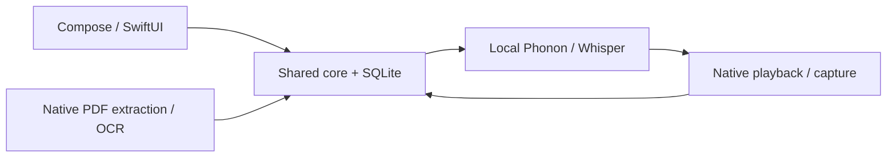

# Architecture

Rhapsodos shares its domain and persistence layer through Kotlin Multiplatform, with native Compose and SwiftUI apps. Documents and speech run locally; public catalogue and model downloads are the network boundary. There is no account, sync service or cloud-processing backend.

## Components

| Component | Responsibility |
| --- | --- |
| [shared/](shared/) | Document passages, source anchors, notes, progress, search, model inventory and the canonical SQLDelight schema |
| [androidApp/](androidApp/) | Compose/Material3 Expressive, Navigation3, adaptive layouts, Koin, Ktor downloads, PDF rendering/OCR and Media3 audio |
| [iosApp/](iosApp/) | SwiftUI/NavigationSplitView, PDFKit/Vision, native audio/capture, URLSession downloads and CoreML inference |
| [native/](native/) | Pinned Phonon runtime libraries and Android Whisper CPU runtime |
| [catalogue/](catalogue/) | Model-release manifests and source descriptors for reproducible archives |
| [tools/](tools/) | Catalogue signing, archive packaging and build checks |

[ReaderCore](shared/src/commonMain/kotlin/com/ereader/shared/ReaderCore.kt) exposes the shared store through a small JSON-based interface, including the Kotlin/Native framework consumed by Swift. Native code owns files, model execution, OS lifecycle and audio transport; neither platform maintains a competing document or note database.

## PDF to narration

Import retains an app-owned original PDF. Native extraction or OCR prepares source text and geometry progressively; the shared core builds passages and keeps source and spoken text distinct. Android uses PDFBox and bundled Tesseract; iOS uses PDFKit and Vision.

The reader draws the original page and overlays passage-level narration highlights. App themes never recolour the PDF. Source ranges use UTF-16; stored `cropTopLeftV1` geometry refers to the unrotated crop box, with rotation applied during native drawing and hit testing.

Native playback time is authoritative. Persisted progress identifies the document and passage, with a source fraction used when regenerated audio has a different duration. Manual page browsing pauses audio and following. Play restores the frozen listening position. Layout changes do not create a new playback session.

Android lowers narration volume for duckable notification sounds. Interruptions that require silence preserve the listening position; both apps resume only when the OS permits and the original playback intent is still valid. Manual pauses, browsing, capture, headphone disconnection and changing documents cancel automatic resumption.

## Voice notes and durable data

Double-tapping prepared text pauses narration and freezes the note's source attachment before capture. A note on another passage uses that passage's start while preserving the book's listening cursor. An equivalent accessible action is available within the PDF surface.

Audio is committed before a note is reported saved. Transcription runs afterward against the saved recording, so missing models or ASR failures do not prevent saving or move its attachment. Machine output and user edits remain separate; a retry cannot overwrite edited text.

Source PDFs, recordings, transcripts and listening positions are durable user data. Generated narration, page rasters and model files are managed separately. iOS seals recordings in device-bound encrypted chunks; Android uses app-private OS-protected storage. Portable document archives deliberately export readable PDF/audio data through the system file picker.

## Downloadable speech

| Task | Android | iOS |
| --- | --- | --- |
| Narration | Phonon 31M CPU runtime | Phonon CoreML runtime |
| Saved-note transcription | Whisper Base English Q8 / whisper.cpp | Whisper Base English / WhisperKit + CoreML |

Each platform downloads one narration archive and one optional transcription archive. English speaker profiles share the same installed Phonon model. Capture, playback preparation and transcription coordinate native resources; unavailable inference leaves saved notes intact. System speech and remote fallbacks are not used.

Each build can specify its own catalogue HTTPS URL and P-256 public key. On launch, the native client fetches the signed catalogue without blocking startup; the cached or bundled catalogue remains available. Verified updates must satisfy shared revision and immutable-edition rules. Refresh never downloads a model or changes a voice selection automatically.

Explicit downloads verify archive sizes and SHA-256 hashes, extract only the declared bounded files, verify payloads and run a local runtime check before activation. A failed replacement leaves the working installation available. Only adapters compiled into the app can run; a catalogue cannot introduce a new inference engine.

See [Setup](docs/setup.md), [catalogue configuration](docs/model-manager.md#release-setup) and [model hosting](docs/model-archives.md) for the operational steps. [AGENTS.md](AGENTS.md) preserves contributor rules and detailed source-integrity constraints.
