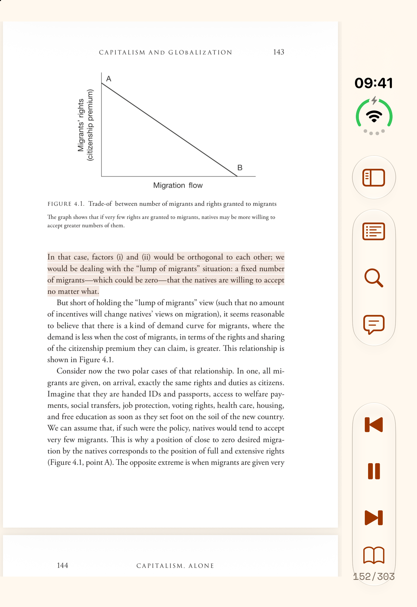
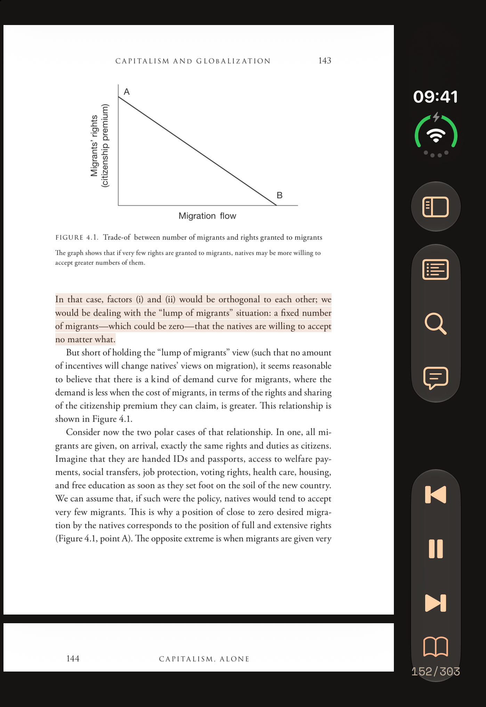
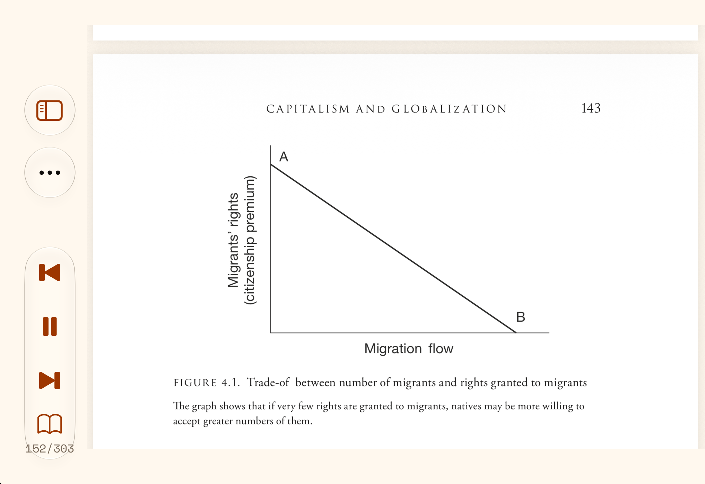
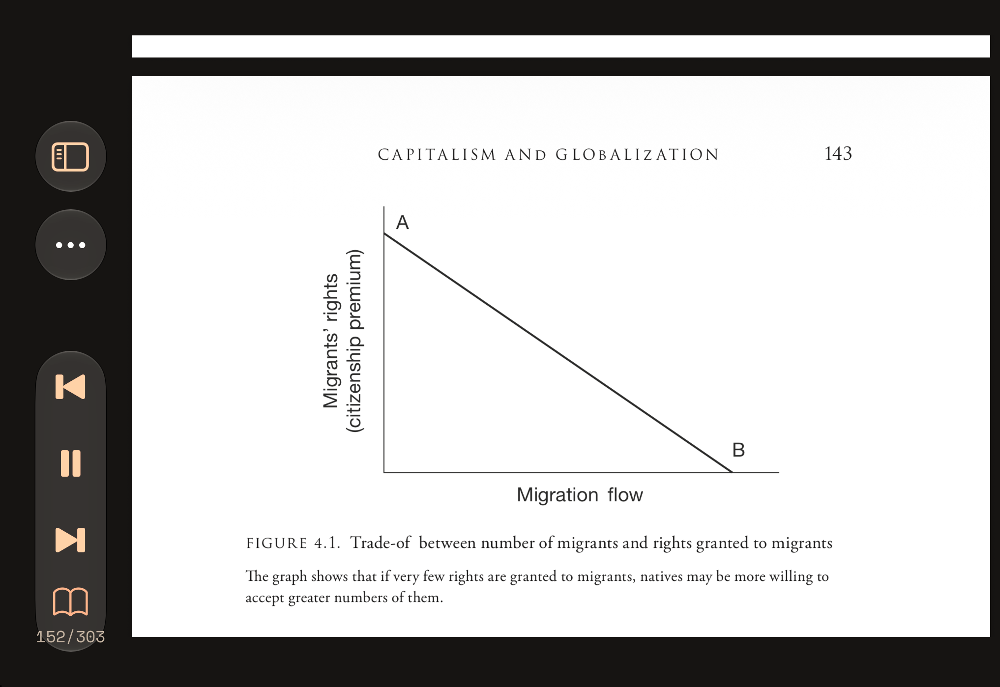
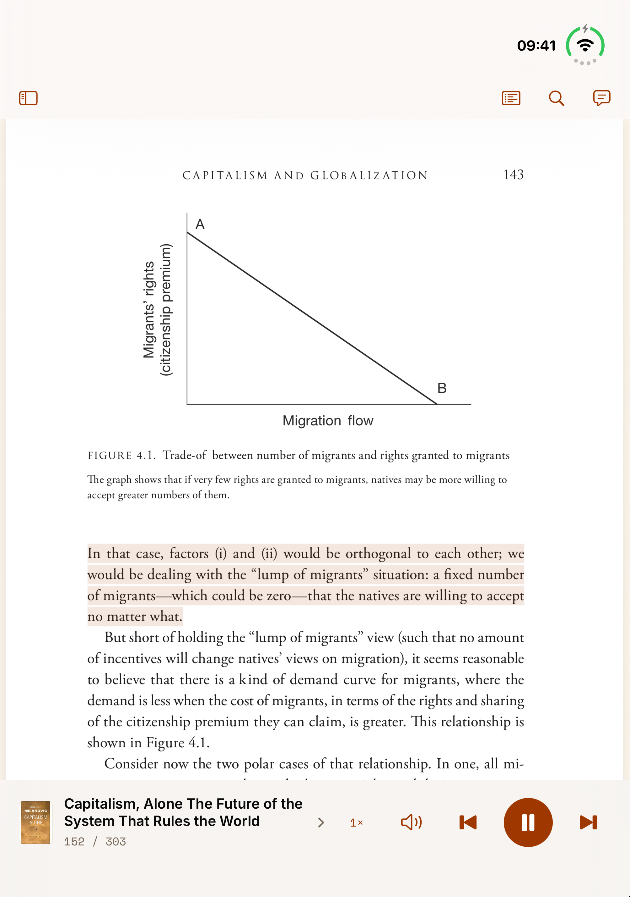
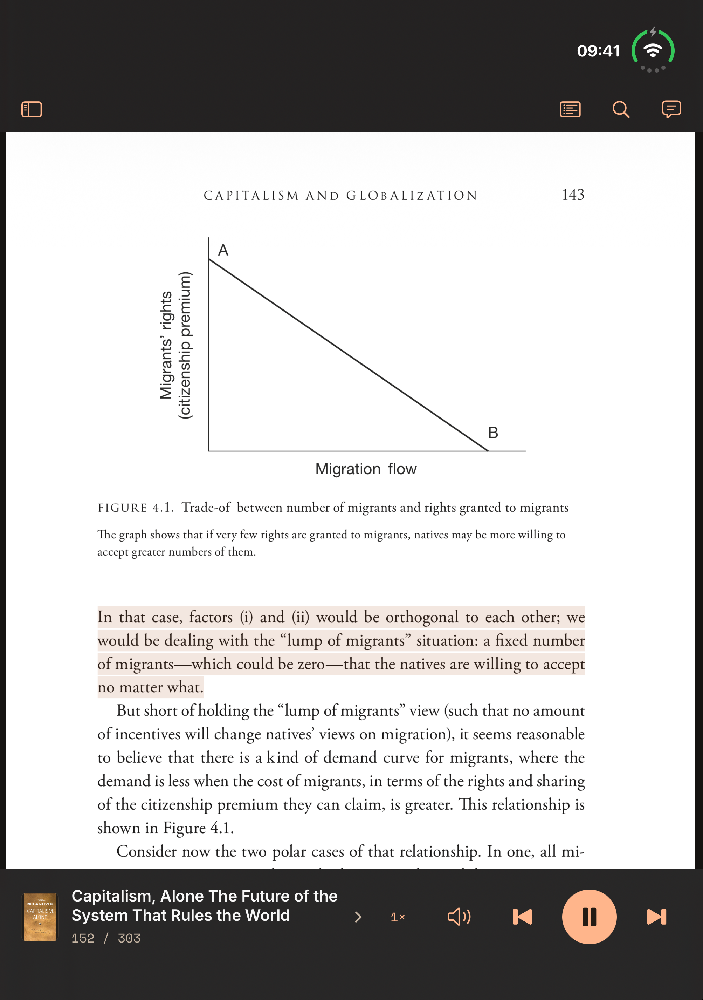
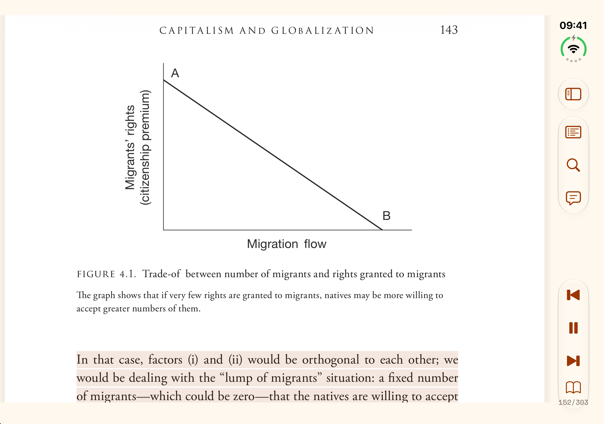
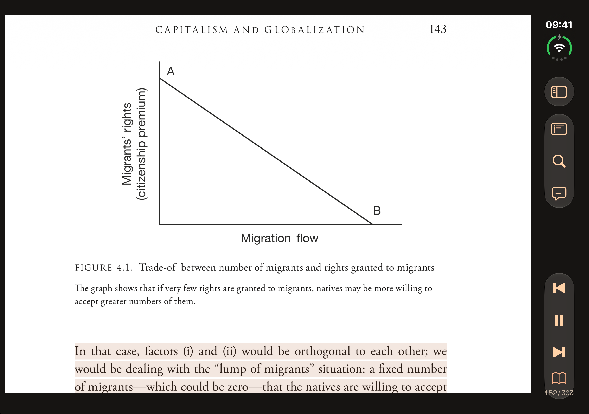

# Rhapsodos

A listening-first PDF reader for Android and iOS. Listen with downloaded voices, follow the highlighted passage on the original page, and record voice notes attached to the text.

- Phonon narration with selectable English voices sharing one model download.
- Optional Whisper transcription for saved voice notes.
- Resume listening, search documents and notes, and export or restore document archives.
- Native phone, tablet and foldable layouts with light and dark appearance.

**Pre-release:** version `0.01`, build `1`. Both apps use `com.osuji.ereaderapp`. Android requires API 28 or newer; iOS requires 18 or newer. Speech packs have additional device checks. Physical-device performance and sustained listening still need qualification.

## Screenshots

| Duo folded · portrait light | Duo folded · portrait dark |
| --- | --- |
|  |  |

| Duo folded · landscape light | Duo folded · landscape dark |
| --- | --- |
|  |  |

| Duo unfolded · portrait light | Duo unfolded · portrait dark |
| --- | --- |
|  |  |

| Duo unfolded · landscape light | Duo unfolded · landscape dark |
| --- | --- |
|  |  |

iPhone Duo simulator captures of mid-book reading in *Capitalism, Alone* by Branko Milanovic. Navigation and playback use the native side rail on the folded display and in unfolded landscape. Unfolded portrait keeps the bottom player. The book/page button opens speed, volume and document details. A small page/total label follows the visible PDF page.

## Run the apps

Follow [Setup](docs/setup.md) for toolchain requirements, Android build/install commands and running the iOS project in Xcode. Native inference libraries are included; ordinary app builds do not require rebuilding them.

A fresh clone can use the bundled model catalogue. Remote catalogue updates are optional: each publisher supplies their own URL and public key through environment variables or an ignored `.env`. See [catalogue setup](docs/model-manager.md#release-setup).

## First listen

1. Open **Settings → Download voices and transcription**, then **Download & use** for Phonon. Choose an English voice after installation.
2. Import a PDF using the **+** button and press **Play** once its text is prepared. The original page follows narration and highlights the current passage.
3. Double-tap a prepared passage to pause and record a note. **Save and resume** returns to the listening position; transcription can finish later.
4. To transcribe notes, enable **Transcribe voice notes** in Settings and complete its download.

Browsing the PDF pauses narration. Play returns to the saved listening position. Opening a book resumes its saved place; progress is shown on each library item. Wide layouts can show the library and notes alongside the PDF.

Open a PDF from a file app by choosing **Rhapsodos** in Android's **Open with** menu or the iOS share menu. Rhapsodos saves its own local copy and opens it without starting narration. If a recording, edit or document operation is in progress, it waits before switching documents. On iOS, accepted imports survive app restarts; **PDF imports** in the library shows waiting or failed requests, with retry or removal when needed.

While listening on Android, use **Picture in picture** in the reader header or go Home to keep the current highlighted passage in a floating window. Use its playback controls or expand it to return to the reader. Closing the floating window pauses narration; recording and document operations stay in the full app. Availability depends on device support and Android's PiP permission.

The first speech-model download needs internet access. Installed models then run locally; documents, recordings and transcripts are not sent to a cloud service. No account or provider API key is required. Notes can be saved without a transcription model.

**Settings → Documents** exports or restores a `.rhapsodos` archive containing the PDF, saved recordings, transcripts and listening position. These archives contain readable user data; models and generated narration are excluded.

## Guides

- [Architecture](ARCHITECTURE.md): shared core, native responsibilities and data flow.
- [Voices and catalogue setup](docs/model-manager.md): offline speech and independent catalogue signing.
- [Model hosting](docs/model-archives.md): package and publish the four model archives.
- [Interface](docs/design.md): shared layout, typography and colours.
- [Third-party notices](docs/third-party.md): dependencies, model terms and bundled licences.

Contributors and coding agents should read [AGENTS.md](AGENTS.md) before making changes.
