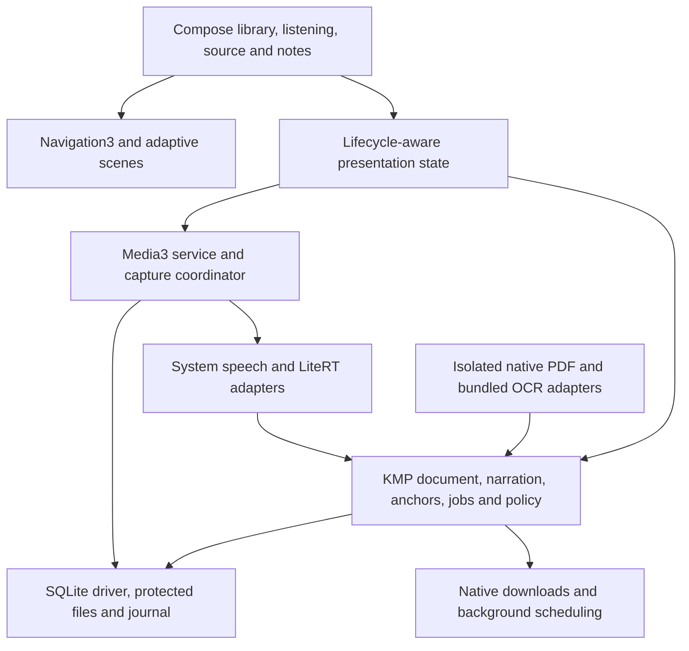

# Android architecture

Status: native implementation and integration qualification, **4 October 2026**. Android starts at API 28. [Development](development.md) records executed checks; physical-device readiness remains to qualify.

The `0.01` app uses native PDF pages, Media3 narration, a capture service, anchored voice/text notes and Compose adaptive scenes. PDFBox provides embedded extraction at API 28; bundled Tesseract processes scans without hidden downloads or telemetry. An isolated service owns PDF rendering/parsing and exchanges descriptors and bounded results with the app. The curated gallery executes pinned Kitten narration and Moonshine saved-file transcription through LiteRT. Missing transcription capability leaves saved audio attached and replayable.

The APK intentionally includes `INTERNET` for explicit public pack downloads. Ktor transfer requests originate in the embedded catalog and use approved HTTPS redirect hosts; downloaded bytes must match pinned sizes/hashes. A data-sync foreground service exposes progress and pause, and interrupted attempts recover safely. There is no document or recording upload provider. Installed system speech is a separate OS service: select voices marked offline and qualify the actual engine.

## Product and stack

Build a native listening app whose PDF surface follows the current narration. A listener can pause, record a thought at the confirmed passage, save and resume while ASR works independently. English, accessibility, offline reliability and non-flagship devices receive first-release attention.

| Technology | Role |
| --- | --- |
| Kotlin Multiplatform | Shared document graph, normalization, anchors, narration editions, repositories, jobs and privacy policy |
| Jetpack Compose | Native Android presentation and accessible interaction |
| Material3 Expressive | Controls, typography, shapes and deliberate motion |
| Material3 Adaptive | Window/posture-aware layout and adaptive navigation integration |
| Navigation3 | Navigation state, entries and adaptive scenes |
| Ktor | Shared ordinary API requests using a suitable Android engine |
| Koin | Android composition root and shared service factories |
| LiteRT | Preferred inference route for qualified Android speech artifacts |
| Media3 | Persistent playback, media session and system media controls |
| Canonical SQLite repositories | Durable domain state through KMP with an Android driver |

The requested stack does not imply every current API is stable. At this research snapshot, the full Material3 Expressive surface is in the 1.5 Alpha line; stable 1.4 does not contain all of it. Material3 Adaptive 1.3 and Navigation3 1.2 have stable releases independently. Check release notes, pin a coherent set and isolate necessary experimental usage. These are dated compatibility facts, not permanent version pins. [Material3](https://developer.android.com/jetpack/androidx/releases/compose-material3), [Material3 Adaptive](https://developer.android.com/jetpack/androidx/releases/compose-material3-adaptive), [Navigation3](https://developer.android.com/jetpack/androidx/releases/navigation3)

## Ownership and composition

Use a small initial module structure: an Android app, shared core/data responsibilities and focused native adapters. Avoid splitting every diagram box into a separate library before there is useful isolation.

Koin constructs repositories, provider registries and native owners at the application composition root. Presentation state holders translate domain snapshots into UI state and dispatch intents. Observe state with lifecycle-aware collection. The UI does not open a database, instantiate a speech model or own a media service.

Native code owns PCM, tensors, renderer objects, recording files and OS lifetimes. Shared code carries IDs, versioned graph values, segment manifests and timing events. Ktor's OkHttp engine is an ordinary networking option; OS-managed durable transfer remains a separate adapter. [Ktor engines](https://ktor.io/docs/client-engines.html), [Koin KMP](https://insert-koin.io/docs/reference/koin-mp/kmp/)

## Document import, rendering and extraction

Import with the Storage Access Framework. Acquire and retain URI access correctly or create an app-owned copy. For the initial dependable offline experience, prefer a controlled seekable copy with a recorded relationship to the original. Providers may expose non-seekable or unavailable sources; handle import/copy errors explicitly. [Document access](https://developer.android.com/training/data-storage/shared/documents-files)

Record logical document ID, immutable source revision and file fingerprint separately. An annotation export or byte-level change must not automatically orphan a note attached to unchanged text.

Evaluate AndroidX PDF for native display/extraction integration, but check its current Beta state and exact feature prerequisites. Its reader/render support was backported to API 28 in the April 2026 releases; do not apply an older whole-viewer Android 12 restriction to that support. Newer framework text APIs have separate platform/extension constraints, so the backport does not prove every extraction feature works at the chosen floor. The framework `PdfRenderer` is an initial lower-level rendering candidate. Alternate engines are qualification choices if the supported corpus exposes material gaps. [AndroidX PDF releases](https://developer.android.com/jetpack/androidx/releases/pdf), [PdfRenderer](https://developer.android.com/reference/android/graphics/pdf/PdfRenderer)

Treat imported PDFs as untrusted input. Evaluate supported sandboxed document loading and isolate parsing where appropriate; a wrapper UI alone is not isolation. Keep page rendering/cache ownership serialized as required by the chosen engine, close pages/descriptors deterministically and avoid blocking the main thread. [SandboxedPdfLoader](https://developer.android.com/reference/androidx/pdf/SandboxedPdfLoader)

Prepare the first page promptly and append committed batches. Embedded extraction feeds the shared graph; Tesseract processes pages with unusable embedded text using bounded rasterization. English data is bundled and pinned in [ocr-manifest.json](ocr-manifest.json). Geometric whitespace cuts establish ordinary column order while source regions retain the exact canonical UTF-16 offsets. OCR/layout errors remain reviewable against the original PDF. Broad tables, footnotes and complex-layout qualification still require the corpus. [Tesseract wrapper](https://github.com/adaptech-cz/Tesseract4Android), [official models](https://tesseract-ocr.github.io/tessdoc/Data-Files.html)

Normalize geometry to the canonical page coordinate system, retaining crop/rotation/raster transforms. Preserve block confidence and extraction provenance. Build reading order before narration, detect duplicate headers/footers and expose uncertain passages instead of inventing missing content.

Persist source ranges as **UTF-16 code-unit offsets into immutable versioned canonical source strings**. Endpoints cannot split surrogate pairs. Shared mappings preserve the relationship between source, accessible display text and spoken text. Qualify Unicode, combining characters and bidirectional text; a PDF glyph index is not automatically a Kotlin text offset.

Compose hosts the original PDF as the main reader, with accessible source text and a record action attached to the current highlight. There is no separate passage/reflow pane. Current-passage overlays come from canonical geometry and timing. Hit testing uses the same fitted, zoomed and panned geometry as painting; only a tap on the active visible highlight enters pause-and-record. Validate expected document/passage identity against the native transport before freezing, and retain the same anchor through the microphone-permission flow. Bound thumbnails, raster pages and inference memory together; rendering several full-resolution pages alongside a large model can exceed the budget even when each subsystem appears reasonable alone.

Use vertical gesture browsing at fitted scale and pinch/pan while zoomed, with equivalent accessibility actions. There is no visible page/zoom/fit toolbar or routine page/voice-status subtitle in the dock. Render the original raster unchanged in the isolated worker, then generate a separate bounded display bitmap off the main thread using the shared neutral-colour mapping in [brand.md](brand.md). Cache identity includes the app paper/ink colours and Original colours preference. The recoloured bitmap has the same dimensions and placement as the original; narration highlights use the theme's primary accent above it. OCR always receives the untouched source raster. This API 28 path does not require RuntimeShader.

Native extraction and OCR convert display rectangles into the shared `cropTopLeftV1` unrotated crop-box convention before persistence. The isolated PDF worker supplies original page rotation for conversion back into the rendered canvas; drawing and hit testing share that transform. Untagged stored regions must be freshly prepared before geometry-only repair. Embedded text must match the complete fresh raw page or that whole page trimmed only at outer whitespace, with every region shifted by the literal UTF-16 prefix offset. OCR requires exact canonical text equality. Do not use fuzzy/substring matching or rotate arbitrary old coordinates by guessing their platform of origin.

## Persistent playback

Use Media3 with a session-owned player and a `MediaSessionService`-style background lifetime where appropriate. Prefer generating system-TTS chunks through `synthesizeToFile` and playing those files through the same Media3 transport as custom-model audio, with explicit sentence/segment alignment. Validate engine support and file completion before enqueueing. [Background playback](https://developer.android.com/media/media3/session/background-playback), [System TTS](https://developer.android.com/reference/android/speech/tts/TextToSpeech)

If direct live TTS output is retained as a fallback, give it a separate transport adapter and declared sentence/utterance precision. It has no ExoPlayer-style seekable media position; callbacks alone do not justify exact mid-word note anchoring. Switching between live and file-backed transport is serialized, with one active owner and source-based resume.

One native owner arbitrates play, pause, seek, capture and routes. Screens connect through a controller/intent facade. Closing the reader, navigating to notes, rotating or resizing does not release the player or reload the model. System notification, headset and lock-screen actions use the same commands as the UI.

The native transport's media position is authoritative. Map it through segment alignment to the source graph. Persist progress at meaningful boundaries and recover it on launch. A shared wall-clock timer must not compete with the transport.

Cache audio with its narration edition, source mappings and declared alignment precision. If a provider has only sentence timing, highlight and attach notes at that explicit precision. Android `onRangeStart` support depends on the engine supplying timing; do not infer sample-accurate cached alignment from callback availability. [UtteranceProgressListener](https://developer.android.com/reference/android/speech/tts/UtteranceProgressListener)

The edition identity includes document/normalization/pronunciation revisions, provider/model/voice and synthesis settings. Player speed changes normally reuse audio. Voice changes create a new edition, retain the source position and prepare it explicitly. Do not silently switch voices when a selected model falls behind.

Prefetch a bounded nearby queue. Cancel or ignore stale work after seeks using input revisions and generation epochs. Prepared chapter audio can support offline listening and slow compatible models. A live seek into unprepared content may require generation; surface that state clearly.

Handle audio focus, calls, competing apps, headphone removal, Bluetooth changes and service recreation. Validate speech rate/time-stretch quality and behavior with TalkBack. Measure actual audible transitions and drift, including device output buffering.

## Voice-note capture and ASR

The shared note record contains both a source anchor and the current narration anchor. The source anchor is frozen **before** microphone capture and survives a voice or audio change.

| Transition | Required behavior |
| --- | --- |
| Pause and record | Confirm the stopped media position, freeze anchors and durably create the draft |
| Request permission | Explain capture and handle denial with typed input at the same anchor |
| Start capture | Stop narration output, configure the recording route and show explicit recording state |
| Save | Finalize the recording, commit its manifest and note, then enqueue ASR |
| Save and resume | Restore the output route and resume independently of transcription |
| Failure/interruption | Preserve recoverable draft/audio and original attachment; no false saved state or unexpected automatic resume |

Use a native recorder with a qualified recoverable format or short recording chunks plus a journal. A crash during an unfinalized file is not guaranteed to leave playable audio. Reconcile finalization and database/file state on restart; remove orphan temporary files only after journal review.

Microphone work has distinct permissions and foreground-service restrictions. Begin capture through a user-visible action while the app is eligible. If background continuation is a supported promise, use the appropriate microphone service configuration and verify its interaction with playback service ownership; a media-playback foreground type does not itself grant microphone access. [Foreground service types](https://developer.android.com/develop/background-work/services/fgs/service-types)

Saving never waits for ASR or network. Each transcription job references an immutable recording revision and stable note ID. Keep machine output separate from user edits. Late/retried jobs cannot change the source anchor, attach to the wrong note or overwrite an edited transcript.

The primary ASR adapter consumes saved files. Android system recognition is capability-dependent and often designed around live recognition; availability of an on-device recognizer alone does not prove stored-audio ingestion works for a selected service. Qualify that route or use a downloadable model. Any local-only native recognition adapter must require a local path and handle unavailable locales/assets without upload. [SpeechRecognizer](https://developer.android.com/reference/android/speech/SpeechRecognizer)

Voice commands and continuous listening for an assistant are outside v1. Optional transcript translation is a separate operation that preserves original audio/text.

## LiteRT and optional inference adapters

Prefer LiteRT for qualified Android artifacts. Use the appropriate current execution API, such as `CompiledModel`, and check actual supported operators, dynamic shapes, accelerator placement and runtime requirements. Compilation support is not a guarantee that an arbitrary graph works on every SoC. [LiteRT Android](https://developers.google.com/edge/litert/android)

The compact KittenTTS sample is a useful first voice candidate. It demonstrates real Android execution, but its Pixel 8a figures do not qualify budget phones or our full pipeline. Local ASR candidates include compact Moonshine/Whisper options and an optional larger Parakeet LiteRT tier. Exact model/runtime/license gates are in [models-and-evaluation.md](models-and-evaluation.md).

Allow a small justified ONNX/native adapter when it delivers better qualified quality or reliability. LiteRT-LM is a separate optional general-language-model capability; the app's core does not depend on it.

Serialize expensive model work on constrained devices. Protect capture/playback first, then immediate prefetch, saved-note ASR and bulk preparation. Check memory/thermal conditions and defer lower-priority work. Model and PDF caches share a total resource budget. Avoid a mandatory large ASR model just to save a voice note.

At 2× playback, live generation needs sustained RTF below 0.5 with headroom. If a model fits memory but cannot keep up, advertise advance chapter preparation rather than universal interactive synthesis. Installed size is not peak resident memory, and pregeneration cannot fix a model that does not fit.

## Curated packs and background work

Model gallery surfaces are **Offline voices** and **Voice-note transcription**. Show samples, language, storage, suitability, privacy and actual readiness. Recommend a compact choice; advanced users can select heavier qualified packs.

Borrow discovery/download/run ideas from [Google AI Edge Gallery](https://github.com/google-ai-edge/gallery), while retaining this app's Koin stack, speech-specific contracts and privacy rules. Gallery's device warnings or demonstration benchmarks are not our compatibility guarantee.

Signed manifests identify platform/runtime/minimum OS, model and conversion versions, frontend, voice assets, language, hashes, licenses, storage and measured profiles. Shared base assets use reference tracking. Arbitrary model import remains later and format-restricted.

Use a durable download adapter with resumable transfer, cancellation and constrained storage accounting. Validate remote version before resuming partial bytes; verify checksum/signature and archive safety, run a compatibility check and activate atomically. Keep the working installation until its replacement succeeds. Recover interrupted downloads/activation on launch. Model removal never removes user notes.

Use WorkManager for suitable persistent deferrable work with checkpoints. Do not treat it as the playback owner or a guarantee of unlimited long-running generation. Recent OS quotas and foreground-service restrictions affect long workers; qualify user-initiated transfer/preparation separately where needed. [Long-running workers](https://developer.android.com/develop/background-work/background-tasks/persistent/how-to/long-running)

Export a truthful offline state: pack installed, source prepared, selected chapters generated and local transcription available/pending are separate facts. Background scheduling can delay ASR; the recording remains saved and replayable.

## Compose, Navigation3 and wide windows

Navigation3 owns the app's navigation state and entry lifecycle. Use saved-state and view-model ownership appropriate to entries; avoid several ad hoc controllers holding contradictory document selection or back behavior.

Material3 Adaptive and Navigation3 adaptive scenes map library/outline-to-source and source-to-notes relationships. Use list-detail/supporting-pane strategies where supported by the qualified dependencies, with one navigation owner. A navigation suite can adapt primary destinations between compact and wide presentation. [List-detail guidance](https://developer.android.com/develop/adaptive-apps/guides/list-detail)

| Available window | Layout |
| --- | --- |
| Compact | Original PDF, persistent player and recorder/notes sheet |
| Medium | Source plus one context pane if content and font scale fit |
| Wide | Outline/library, PDF and anchored notes with a persistent dock |
| Very wide | Adjustable bounded panes and readable text measure; optional context without stretched controls |

Choose layout from actual window constraints, font scaling and posture. Account for hinges and avoid placing important controls across an occlusion. Preserve source selection, scroll/zoom, auto-follow state, note draft, transcript edits and actual audio position as panes change.

Manual scrolling suspends following until the listener chooses to return. Notes and source scroll independently. A panel transition does not reconstruct media or inference ownership. See [design.md](design.md) for the shared layout policy.

Expose current source text and a pause-and-record action on the PDF highlight, with useful TalkBack order, named controls and non-color recording cues. Do not move accessibility focus with every highlight or announce every partial transcript. Verify large text, reduced motion, keyboard/pointer, switch access and narration/screen-reader coexistence.

## Persistence and privacy

Use one canonical SQLite schema and repository layer through KMP with an Android driver. SQLDelight is the initial implementation choice. Do not add a second Android-only domain schema. Preference storage can hold harmless UI settings; documents, notes, jobs and progress remain in the canonical store.

Transactions, file manifests and journals coordinate durable recordings and derived audio. On launch recover/checkpoint jobs, verify committed assets and safely reconcile orphan files. Lexical search is first; validate FTS support in the selected driver/build before making it a dependency.

Use native key storage and an explicit protected/encrypted data design. Include recording drafts, metadata, transcripts, database journals and indexes, rather than encrypting only final audio. Qualify lock-screen key availability, restore/export and backup exclusions. Keep reproducible models/caches distinct from user-owned originals and recordings.

The shared privacy policy is enforced by every adapter, including retries, diagnostics and sync. Local-only content must not leave the device. Public model download networking is a separate operation; do not upload filenames/text as telemetry. Optional cloud narration, note ASR, document processing and sync have independent choices.

Content-free operational metrics can help diagnose latency and failures; raw documents, passages, audio and transcripts do not belong in normal logs. Provider keys must not be embedded in the app.

## Qualification and contributor workflow

Before selecting the API floor, verify rendering/extraction fallbacks, foreground-service behavior, recognition capabilities, runtime versions and library constraints on the actual audience devices. Native inference libraries also need ABI/package qualification, including 16 KB page-size support on relevant devices. [Page-size guidance](https://developer.android.com/guide/practices/page-sizes)

Required evaluation includes:

- Difficult PDFs and gold reading-order/source-position comparisons.
- Long playback, speed changes, seek, PDF zoom/page browsing and source/voice revisions without incorrect attachments.
- Active-highlight taps, blank-space taps, pan/pinch, rapid taps and passage-boundary races; only the confirmed current source may enter capture.
- Save/resume, denied permission, low storage, interrupted capture, process death and stale ASR completion.
- Screen lock, audio focus, calls, routes, Bluetooth and service recreation.
- Compact/wide/resizable/foldable layouts with large text and assistive technologies.
- Lower-memory physical devices, joint rendering/inference load, thermal throttling and battery measurements.
- Airplane mode and controlled network checks of all local-only failure paths.
- Corrupt/interrupted pack downloads, failed upgrades and safe removal while dependent work exists.

Follow [AGENTS.md](../AGENTS.md): keep comments essential, do not commit or leave unit-test source in the repository, run meaningful appropriate checks and track coherent changes in validated atomic commits. Temporary unit checks belong outside the repository. Remove obsolete pre-release features and internal compatibility shims freely while preserving real user data, unrelated work and current durability guarantees.

Decisions now implemented include API 28, pinned Gradle dependencies, SQLDelight ownership, recoverable PCM WAV capture, app-private OS-protected storage, portable archive restore, bundled English OCR and the initial LiteRT speech packs. Remaining qualification concerns are source fidelity across the broader corpus, resource/route behavior on physical devices and the release quality gates above.
