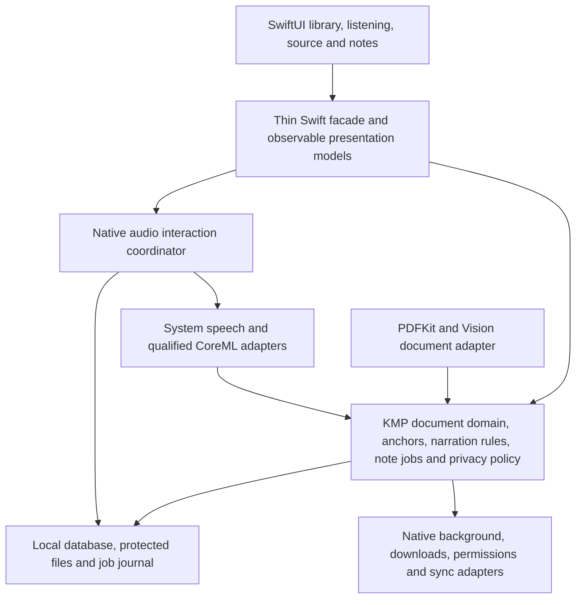

# iOS architecture

Status: native implementation and integration qualification, 4 October 2026. The deployment floor remains iOS 17; newer APIs and packs are gated. [Development](development.md) records executed evidence. Physical-device speech and performance qualification remains open.

The `0.01` app uses PDFKit/Vision progressive preparation, SwiftUI split navigation and an inspector, system narration and encrypted recording chunks. Its curated downloads provide Whisper tiny English transcription on iOS 17 and optional Kokoro CoreML voices on eligible iOS 18+ devices. Native background URLSession transfers verify artifacts and runtime readiness before activation. The attachment reports passage precision with native audio offset; word-aligned timing is not advertised.

Owned locators are relative to the app's data root so container relocation remains safe. Automatic backup is disabled; the recording key is non-synchronizing and device-bound. Deliberate portable ZIP export renders protected audio to PCM16 WAV with source/notes intact; restore verifies the envelope and seals audio with the receiving device's key. There is no remote key recovery. Vault checks reject truncated committed audio. An interrupted draft can explicitly recover its authenticated prefix into a verified durable asset before canonical commit; its original remains owned recovery data until deliberate note/document deletion. Recovered notes use the same strict playback, ASR and export paths as complete recordings.

## Product intent

This is a listening app for PDFs and books, with reading as a companion to listening. The central screen follows the passage being narrated. A person can pause, record a thought, save it against that exact passage, and resume while transcription continues separately.

The first release prioritizes English, accessibility, offline reliability and older supported iPhones. The document and speech contracts retain language metadata so multilingual support can grow without replacing the domain model. Transcription is the default meaning of converting a voice note to text. Translation is a separate, explicitly selected operation and must preserve the original recording and transcript.

The essential guarantees are:

- Playback, reading position and annotations refer to the same source passage.
- The pause position is frozen before recording begins and cannot move when transcription finishes.
- Saving a voice note does not depend on ASR succeeding or a network connection being available.
- The app remains useful with system speech and local document processing; downloading a large model is optional.
- Local-only mode prevents content from leaving the device, including through automatic fallbacks.
- Resizing the app or changing navigation does not recreate the audio session or lose a note draft.

## Native app and shared core

Use Swift and SwiftUI for the iOS app. Kotlin Multiplatform shares business rules and durable domain contracts with Android. Keep native document rendering, audio, recording and inference resource ownership in Swift.

The diagram describes ownership boundaries, not a requirement to create a framework or package for every box.

| Component | Responsibility | Owner |
| --- | --- | --- |
| App composition | Construct dependencies, native capabilities and shared services | Swift composition root |
| Shared domain | Document identity, normalization, segmentation, source mappings, anchors, cache identity and job state | KMP |
| Presentation | Navigation, observable screen state, user actions and accessibility | SwiftUI and Swift |
| Document adapter | Import, rendering, extraction, OCR and coordinate conversion | PDFKit, Vision and Swift |
| Audio coordinator | Playback/capture transitions, interruptions, routes and native media controls | Swift |
| Speech adapters | TTS/ASR execution, model loading and audio output | System APIs and CoreML through Swift |
| Persistence | One canonical SQLite schema, repositories, transactions, search, file manifests and job recovery | KMP repository layer with native database/file/crypto adapters |
| Platform execution | Background scheduling, downloads, protected-data availability and permissions | Swift |

Koin can construct shared services and expose shared factories. Swift receives explicit dependencies at the composition root. SwiftUI views should not perform service lookup or know about the Koin container.

### Swift interop

Initially use a Kotlin/Native framework behind a small Swift facade. Expose commands, immutable snapshots, identifiers and lifecycle-controlled subscriptions. Keep PCM buffers, PDF objects, image tensors and model objects inside native adapters. The bridge should carry passage and timing events rather than individual audio samples.

Current Swift export supports suspending functions as Swift `async` and flows as `AsyncSequence`, but remains Alpha, requires direct integration with Xcode, and has export/generic limitations. Evaluate it against the established framework route through the same facade before choosing the release bridge. [Kotlin Swift export](https://kotlinlang.org/docs/native-swift-export.html)

The facade must define cancellation, errors, delivery actor and subscription disposal. The framework bridge does not automatically make every Kotlin exception a recoverable Swift error; undeclared exceptions crossing that boundary can terminate the app. Use explicit domain failures and correctly declared throwable boundaries. Newer platform API availability belongs in Swift adapters; Kotlin's Objective-C interop can strongly link unavailable symbols even when the corresponding code is never executed. [Kotlin Swift/Objective-C interop](https://kotlinlang.org/docs/native-objc-interop.html)

Use a main-actor presentation layer and native actors or serial owners for mutable document sessions, audio transitions and model execution. Kotlin coroutine work must not update SwiftUI state directly. Cross-language closures and subscriptions have explicit close/cancel ownership to avoid retaining a dismissed screen or stopped session.

## Document pipeline and source identity

1. Import through the system document picker, acquire file access correctly, and choose an app-owned copy or a managed external reference. Record that choice. An app-owned copy is the simpler initial option for dependable offline playback.
2. Record a logical document identity, immutable source revision, byte fingerprint and import metadata. Rendering changes or annotation export must not silently replace the logical identity and orphan notes.
3. Render immediately through PDFKit. Extract embedded text and page geometry incrementally. Use bounded page and thumbnail caches.
4. Detect missing, unusable or duplicated text. Run Vision OCR for pages that need it; preserve OCR confidence and provenance.
5. Feed extraction into the shared canonical document graph: pages, blocks, reading order, source text, geometry, language and confidence.
6. Produce deterministic narration segments and explicit mappings from spoken text back to the original source. Index and pre-generate only as resources allow.

Bridge `PDFView` into SwiftUI as the main reader surface. The canonical graph drives narration, accessible source context, search and anchors; there is no separate "Listen and follow" or reflow pane. PDFKit's Live Text support can improve selection and search on scanned pages, but it does not replace the app's durable reading-order and source-mapping pipeline. Per-page overlays display the current spoken range and note markers. A tap must hit the active highlight in PDF page coordinates before dispatching pause-and-record for its expected document/passage identity. Blank-space taps, scrolling, zoom and text selection retain native PDF behavior. [PDFKit enhancements](https://developer.apple.com/videos/play/wwdc2022/10089/)

Convert all extracted geometry into a documented coordinate convention. PDFKit character bounds use page coordinates; Vision text regions use normalized image coordinates. Account for page rotation, crop boxes, raster scale and the lower-left versus upper-left origins before showing highlights. [PDFPage character bounds](https://developer.apple.com/documentation/pdfkit/pdfpage/characterbounds(at:)), [Vision OCR](https://developer.apple.com/documentation/vision/recognizing-text-in-images)

Emit `geometrySpace = cropTopLeftV1` for new source pages, including embedded PDFKit line/range regions for cross-platform archives. Vision display rectangles are unrotated into the normalized top-left crop box before persistence; PDFKit converts that crop geometry into the rendered page. Untagged OCR regions require fresh recognition and exact canonical page-text equality before geometry-only repair. Embedded geometry requires equality with the complete raw PDFKit page text or that whole text trimmed only at outer whitespace, with an explicit literal UTF-16 prefix offset. No substring, fuzzy or internal-whitespace matching is allowed. Native selection uses exact raw-source offsets; trusted persisted regions provide the fallback for externally ordered source text.

Normalization is shared because it affects playback and note identity: dehyphenation, whitespace, abbreviations, pronunciations, headers/footers and footnotes can change spoken text. Preserve source text independently and retain a many-to-many source-to-spoken mapping. Do not locate notes by searching a regenerated transcript alone. Tables, equations and figures require explicit narration policies; uncertain extraction must remain visible and correctable rather than silently inventing content.

A source anchor should contain at least:

- Logical document ID, source revision and graph version.
- Stable block/passage identity and persisted UTF-16 code-unit offsets into the immutable, versioned canonical source string.
- Page index and normalized geometry where available.
- Quoted text plus surrounding context for repair or migration.
- Narration segment ID, spoken range and playback offset when the note was created.

Persisted range endpoints cannot split surrogate pairs. Swift must convert explicitly between these UTF-16 offsets and `String.Index`; do not mix Swift grapheme counts with Kotlin string offsets. Validate emoji, combining marks, non-Latin scripts and right-to-left text. A page number or audio timestamp alone is insufficient: page layouts and generated audio can change. Reprocessing should migrate anchors through versioned source mappings and flag ambiguous matches for review.

## Listening and voice-note lifecycle

One `AudioInteractionCoordinator` owns the native playback/capture lifecycle. ASR is an independent, durable job for each note. The UI can therefore show a playing session while a previously saved note is still transcribing.

| Event | Required behavior |
| --- | --- |
| Pause to add a note | Stop at a confirmed playback position, freeze its source anchor and persist the draft before microphone capture |
| Microphone access denied | Keep the frozen passage and offer typed input; do not move the anchor |
| Begin recording | Activate the capture configuration and make recording state unmistakable |
| Save | Finalize the audio file, commit the recording manifest and anchored note transaction, then enqueue ASR |
| Save and resume | Resume from the frozen listening position once capture is safely finalized; transcription need not finish |
| ASR failure | Keep the recording and anchor; offer retry and transcript editing |
| Interruption or process termination | Recover the committed note or recoverable draft; never report an unsaved recording as saved |

The audio journal tracks draft, recording, finalization and commit state. Persist encrypted note drafts and short recoverable recording chunks, or another qualified encrypted recoverable format, then finalize atomically. Garbage collection removes orphan temporary files only after checking the journal. The UI reports “Saved — transcribing” only after durable audio and metadata commit. A transcript update is idempotent and cannot overwrite a user's edited transcript without an explicit conflict policy.

The frozen anchor belongs to the pause action, not ASR completion. If the person browses another passage while recording, show the original attachment clearly and require an explicit reattach action to change it.

### Native audio behavior

Use `AVAudioSession`, `AVAudioEngine` or an appropriate native playback component, `MPNowPlayingInfoCenter` and `MPRemoteCommandCenter`. The system's playback category supports background audio and playback with the silent switch engaged; enable the corresponding app background capability for active narration. Use spoken-audio behavior deliberately and validate its interaction with VoiceOver. [Playback category](https://developer.apple.com/documentation/avfaudio/avaudiosession/category-swift.struct/playback), [spoken-audio mode](https://developer.apple.com/documentation/avfaudio/avaudiosession/mode-swift.struct/spokenaudio)

Treat playback-to-recording as a serialized state transition. Stop the narration output, establish the capture route/session configuration, start recording, finalize, then restore playback configuration. A playback-only configuration does not provide microphone capture. `.playAndRecord` may be appropriate while recording, but Bluetooth routing and supported options need physical-device qualification; entering capture can change route or sound quality. Do not assume the output route before recording is still available afterward.

Handle phone calls, Siri, competing audio, route changes, Bluetooth disconnection and media-services reset. Persist position at meaningful boundaries. An interruption ends in a recoverable paused or draft state; any automatic resume must respect the OS interruption signal and the user's current intent. Avoid unintentional narration restarting after a call or capture interruption.

The primary interaction can expose “Pause and record note” as one action. Saving and resuming remains explicit. Do not require a live partial transcript to operate the recorder. Keep recording duration, stop, cancel and recovery understandable with VoiceOver and on a small screen.

### TTS alignment

`AVSpeechSynthesizer` provides an on-device baseline. Its delegate reports the text range about to be spoken; this supports live highlighting but is not a sample-accurate alignment track for cached custom audio. [Apple speech synthesis](https://developer.apple.com/documentation/avfoundation/speech-synthesis), [speech-range callback](https://developer.apple.com/documentation/avfaudio/avspeechsynthesizerdelegate/speechsynthesizer(_:willspeakrangeofspeechstring:utterance:))

For custom generated audio, cache segment files with durations and alignment metadata. Derive source position from the native playback clock and the segment's validated alignment. If a model cannot supply dependable word timing, use sentence or passage highlighting and seek boundaries. Do not present fabricated word precision. Preserve source mapping when pronunciation fixes or excluded headers change the spoken string.

Maintain a small look-ahead buffer and bounded audio cache. Cache keys include source/normalization versions, voice and model version, language, pronunciation settings and synthesis parameters that affect audio. Playback-speed changes applied by the player should be distinguished from synthesis-speed changes that require different audio.

## SwiftUI and wide-screen policy

The phone has a focused listening view, a source view and accessible note capture. The iPad uses space for context while keeping listening controls central to the task.

Use `NavigationSplitView` for library/outline navigation and the reader detail. Use the iOS 17 `.inspector` API for passage notes and related detail. Notes are supplementary context, not a downstream navigation destination. The inspector adapts to a trailing panel or compact sheet; column collapse should preserve the active document and session. [NavigationSplitView](https://developer.apple.com/documentation/swiftui/navigationsplitview), [SwiftUI inspectors](https://developer.apple.com/videos/play/wwdc2023/10161/)

| Available space | Intended layout |
| --- | --- |
| Compact window | One active destination; persistent mini-player; notes as a sheet or destination |
| Medium window | Source with a selectable outline or notes panel; keep controls reachable |
| Wide window | Outline/library, source and notes inspector visible together where useful |
| Very wide window | Bound reader line length and panel widths; use spare space for useful context rather than stretching text |

Use actual available window size and accessibility text size, not device identity or orientation. Collapse the notes inspector before sacrificing a usable reading column. Give panels sensible preferred widths, allow native visibility controls, and restore selection. SwiftUI may adjust preferred column widths to satisfy other constraints. Validate iPad resizable windows and multitasking. [Apple split-view guidance](https://developer.apple.com/design/human-interface-guidelines/split-views)

The playback dock is attached to a session-level container. Resizing, rotation or opening a note must not recreate playback, reload the model, move the frozen anchor or discard the draft. A large book cover must not displace the current passage and recording action in wide listening mode.

The original PDF remains a faithful document canvas with zoom and the active narration highlight. Dynamic Type applies to controls and accessible source context. Expose the current excerpt and an equivalent pause-and-record action within the PDF surface without adding a visible reading pane. Two-page spreads are a reading preference, not the default layout for following narration.

### Accessibility

Provide meaningful VoiceOver order, stable focus, named controls and passage actions. Expose headings, bookmarks and notes through useful navigation semantics or rotors. Do not move accessibility focus on each word highlight or repeatedly announce partial transcripts. Validate narration with VoiceOver enabled: the user must be able to inspect and operate controls without losing their place or having two voices talk over each other.

Support large Dynamic Type, sufficient contrast, reduced motion, Switch Control and Voice Control. Keyboard commands should help play/pause, navigate and add notes without intercepting text entry. Recording state needs text and semantics in addition to color or waveform animation. The transcript editor must retain the original recording and attachment context.

## Local speech and downloadable packs

The current app processes content locally. Explicit model downloads fetch public assets; document text and voice recordings are not uploaded. A future cloud mode requires separate content permissions and an enforceable local-only policy. A failed local pack leaves a useful preparation, repair or built-in-voice choice.

| Capability | iOS 17 baseline | Qualification rule |
| --- | --- | --- |
| Narration | Available system voices through `AVSpeechSynthesizer` | Confirm installed voice, language and playback behavior |
| Voice-note transcription | Qualified compact CoreML ASR pack; optional system recognizer where offline capability is available | Validate model OS/runtime support and actual offline operation |
| OCR | Vision page-level recognition | Measure layout/reading-order quality and memory use |
| Enhanced local voice | Built-in narration on iOS 17; optional CoreML pack on eligible iOS 18+ devices | Sustained narration must keep up or use explicit preparation |
| Local language model | Optional later feature | Never required for opening, listening or saving a note |

Legacy `SFSpeechRecognizer` exposes an on-device capability check, but availability varies. Set the on-device requirement when private mode uses that adapter and handle unsupported locales/assets without silently using a server. Microphone permission is necessary for capture; legacy system speech recognition also has a speech-recognition authorization flow. [On-device recognition support](https://developer.apple.com/documentation/speech/sfspeechrecognizer/supportsondevicerecognition), [speech authorization](https://developer.apple.com/documentation/speech/asking-permission-to-use-speech-recognition)

CoreML is the iOS inference baseline. `MLComputeUnits.all` allows the OS to select eligible compute resources; it does not promise that every operator or model runs on the Neural Engine. MLX is a separate runtime and should only be added for a justified, qualified model. A library's minimum deployment target is not proof that every model it loads supports iOS 17. [CoreML compute units](https://developer.apple.com/documentation/coreml/mlcomputeunits)

The implemented enhanced voice uses the pinned FP32 end-to-end Kokoro export on CPU only, with a conservative iOS 18 and 3 GB eligibility floor. Its 128-token input and five-second output buffer require strict duration checks and complete source rechunking. The adapter accepts at most 4.75 seconds per acoustic call, verifies duration/frame consistency and caches bounded PCM WAVs under the source, voice, pace, frontend and model editions. The retained offline English frontend treats PDF text literally, without pronunciation markup. Unsupported pronunciation must fail explicitly; it must never silently drop a letter. [models-and-evaluation.md](models-and-evaluation.md) records the artifact and qualification evidence.

### Curated gallery

Present voices and transcription packs in a curated gallery. Show an audible voice sample, language, quality description, download size, installed size, privacy behavior and a truthful suitability result for the current device. Offer “Recommended for this device”, with optional advanced choices.

Each signed catalog entry needs model/voice identity and version, exact runtime and minimum OS, tokenizer/frontend version, required shared base assets, language coverage, sample rate, license, download/installed/temporary storage estimates, tested peak memory, thermal behavior and sustained performance measurements. Define cancellation, integrity verification, atomic activation and rollback. Downloads can use native background URLSession transfers; download success is distinct from a usable compiled model. [Background downloads](https://developer.apple.com/documentation/foundation/downloading-files-from-websites), [CoreML download and compilation](https://developer.apple.com/documentation/coreml/downloading-and-compiling-a-model-on-the-user-s-device)

Keep the working pack until its replacement passes validation. Exclude reproducible model weights and generated caches from backups. Deleting a pack must not delete notes or recordings. Shared base assets need reference tracking so choosing several voices does not multiply the same download unnecessarily.

### Older-device policy

Classify capability through measured workload and current resource conditions, not a flagship-only assumption or advertised RAM. `os_proc_available_memory` is a changing advisory estimate of the process's available memory; it is not a guarantee or an allocation budget to consume completely. Thermal state should reduce or suspend optional work. [Available process memory](https://developer.apple.com/documentation/os/os_proc_available_memory), [thermal state](https://developer.apple.com/documentation/foundation/processinfo/thermalstate-swift.property)

Protect interactive rendering, capture and audible playback first. Run one heavy inference job at a time by default; defer indexing, distant-page OCR and enhancement work. For slow voice models, offer advance generation of a chapter or selected section with an honest preparation state. Voice-note ASR can complete asynchronously or wait for suitable resources because the saved recording already preserves the thought.

Qualification must cover prolonged playback with PDF rendering, model warm-up, seek, capture transitions and thermal pressure. A short isolated model benchmark is insufficient. If an enhanced voice cannot sustain playback, retain the user's selected voice and show a preparation/fallback choice rather than changing voices unnoticed.

## Persistence, jobs and privacy

Use one canonical SQLite schema and repository layer through KMP for documents, passages, anchors, notes, transcripts, model inventory and the job journal. Native adapters provide the database driver, protected files and cryptographic execution. SQLDelight is the initial implementation choice; do not create an independent iOS schema or a second SwiftData source of truth. Start with lexical search. FTS5 offers ranking and snippet capabilities, but select the FTS integration only after checking the chosen driver and SQLite build. Vector search can be added later if it improves a defined task. [SQLite FTS5](https://www.sqlite.org/fts5.html)

Journal OCR, synthesis, ASR and sync jobs with stable IDs, input revisions, output manifests, retry/cancel state and bounded work checkpoints. On launch, reconcile in-flight jobs with files and committed records. Derived audio and indexes are rebuildable; raw voice notes and user edits are user data and need a distinct retention policy.

Local-only policy must cover every path that can carry content: speech adapters, OCR, AI requests, sync, diagnostics, crash attachments and analytics. Document text, filenames, quotes, note audio and transcripts do not belong in ordinary logs. Model downloads are a separate, explicit network operation for public assets; they must not upload document content. Sync and cloud inference are separate choices with separate permissions.

Use native file protection and authenticated application encryption for note drafts and recordings from their first durable write. Apply the chosen protection policy consistently to metadata, transcripts, temporary files, database journals and searchable indexes; encrypting only the final audio file leaves sensitive intermediate material behind. Decide locked-device behavior explicitly: narration may need to open cached audio while locked. Apple's `completeUntilFirstUserAuthentication` file protection remains accessible after the first unlock until reboot; an after-first-unlock Keychain class can support background access, while a when-unlocked class restricts it. Align encrypted-file key availability with the promised background behavior. [File protection](https://developer.apple.com/documentation/foundation/fileprotectiontype/completeuntilfirstuserauthentication), [background-access Keychain class](https://developer.apple.com/documentation/security/ksecattraccessibleafterfirstunlockthisdeviceonly), [when-unlocked Keychain class](https://developer.apple.com/documentation/security/ksecattraccessiblewhenunlockedthisdeviceonly)

Device-only keys do not migrate to a different device. Backup, restore, export and optional cross-device sync therefore need a deliberate key-recovery design; an encrypted backup without a recoverable key is not a usable backup. Keep platform secrets in Keychain and cryptographic execution in native adapters behind shared policy.

Cross-platform sync is a later service contract with shared conflict rules and native transport/background adapters. Do not assume iCloud automatically gives every third-party app an end-to-end-encrypted design. SwiftData's CloudKit synchronization also imposes schema constraints. Decide encryption, recovery and sync requirements before choosing a transport. [iCloud encryption](https://support.apple.com/guide/security/icloud-encryption-sec3cac31735/web), [SwiftData synchronization](https://developer.apple.com/documentation/swiftdata/syncing-model-data-across-a-persons-devices)

## Background execution and newer APIs

Active narration and ordinary background processing are different capabilities. Background audio is for real playback, not a general entitlement to run OCR, ASR or generation indefinitely. On iOS 17, background tasks are discretionary and can expire; checkpoint work and recover on the next available execution opportunity. Do not promise that a note always finishes transcribing while the app is closed. [BGProcessingTask](https://developer.apple.com/documentation/backgroundtasks/bgprocessingtask)

| Optional capability | Adoption policy |
| --- | --- |
| iOS 18 CoreML stateful models and related transformer improvements | Use where a qualified pack benefits; keep the iOS 17 baseline operational |
| iOS 26 `SpeechAnalyzer` and its transcription modules | Check runtime device, locale and asset availability; use a supported fallback |
| iOS 26 richer Vision document recognition | Improve structure extraction where available without changing anchor contracts |
| iOS 26 continued processing | Consider for explicit user-started preparation; check supported resources and cancellation |
| Newer system intelligence APIs | Evaluate separately; no baseline dependency or assumption that all iOS 17 devices qualify |

These are feature adapters, not reasons to increase the minimum OS silently. SpeechAnalyzer includes asset management and newer local transcription behavior; supported devices and locales still require runtime checks. [SpeechAnalyzer](https://developer.apple.com/videos/play/wwdc2025/277/), [CoreML updates](https://developer.apple.com/videos/play/wwdc2024/10159/), [Vision documents](https://developer.apple.com/videos/play/wwdc2025/272/), [continued background processing](https://developer.apple.com/videos/play/wwdc2025/227/)

## Validation and unresolved decisions

Follow [AGENTS.md](../AGENTS.md) for verification and contributor policy. Validation is proportional to risk. Use compile/static checks, manual verification, physical-device qualification and appropriate integration/E2E scenarios. Temporary unit checks and experimental harnesses may run outside the repository, such as in a task-specific temporary directory; do not add or leave unit-test source files in the repository or include them in a commit. Do not create checks that merely restate implementation details.

Track work in validated, coherent [atomic commits](../AGENTS.md#atomic-commits), with deliberate staging and coordinated commit ownership. The integration owner may commit reviewed delegated changes. Git has been initialized for the authorized implementation; pushing or publishing remains separate.

Before calling the listening loop ready, validate:

- Embedded-text, scanned, rotated, multi-column and long PDFs; incorrect order and low-confidence OCR remain reviewable.
- Source highlighting and frozen anchors through pronunciation changes, PDF zoom/page browsing, seek, app restart and document reprocessing.
- Active-highlight taps, blank-space taps, text selection, pan/pinch, rapid taps and passage-boundary races; only the confirmed current source may enter capture.
- Pause, denied permissions, capture, save, immediate resume, delayed/failed ASR and edited-transcript conflicts.
- Calls, Siri, route loss, Bluetooth microphones, lock/unlock, protected-data availability, low storage and termination during recording/finalization.
- Sustained narration on older supported hardware alongside source rendering; record latency, peak memory, energy/thermal behavior and underruns.
- Local-only operation with network unavailable and controlled network observation; verify no content egress or server fallback.
- Compact iPhone, wide iPad, resizable windows, large Dynamic Type, VoiceOver, Switch Control, Voice Control and keyboard operation.
- Model download interruption, compilation failure, replacement rollback, removal and recovery after process termination.

Implemented decisions include SQLDelight ownership, the Kotlin/Native facade, bounded PDFKit/Vision preparation, authenticated encrypted recording chunks, local Keychain policy, portable archive restore and pinned CoreML packs. Commercial PDF engines remain an option if corpus qualification exposes a material gap. Device-specific speech quality, endurance and the oldest supported runtime remain empirical release gates.

Keep comments sparse and essential. During the pre-release build, obsolete features and internal APIs may be removed rather than maintained behind unnecessary backward-compatibility layers. Disposable development fixtures may be reset. Preserve real recordings, user edits and unrelated user work throughout development; pre-release status does not make them disposable. Retain source-anchor integrity, atomic model replacement, explicit export/restore promises and the chosen iOS 17 deployment floor.
